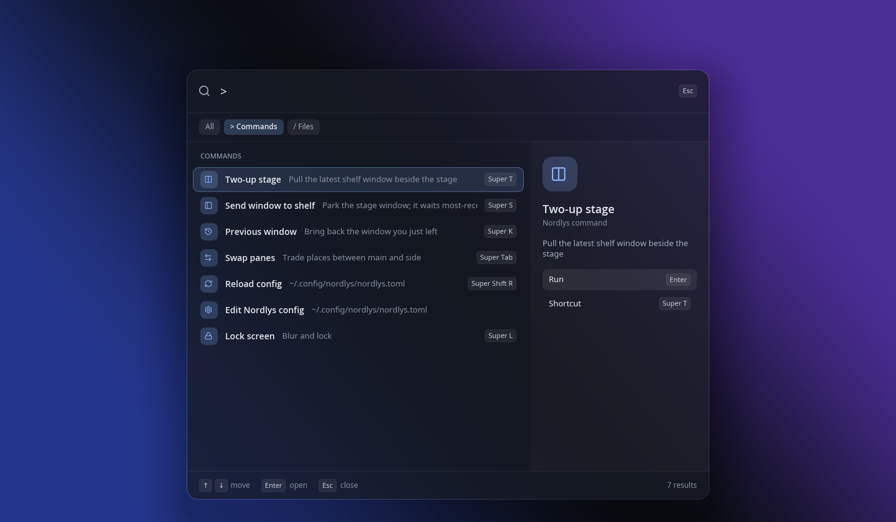
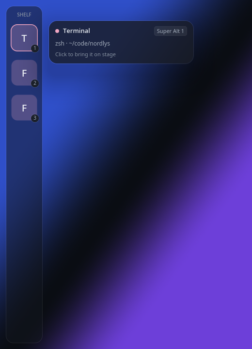
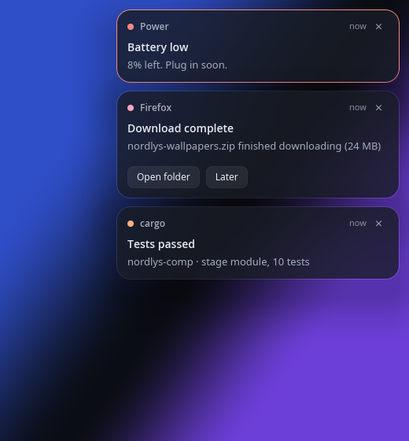
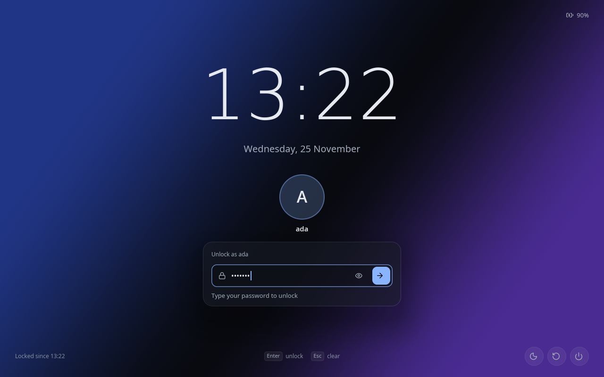

# Nordlys

A frosted, keyboard-first Linux desktop, written in Rust.

The newest window always takes the centre of the screen. The window it
replaces goes to the front of the shelf beside it. Workspaces, app groups
and the same keys work on every screen size, from ultrawide to laptop.

> Early days. The shell (bar, launcher, shelves, notifications, lock
> screen) runs as a session on Hyprland. nordlys-comp, the Stage
> compositor, runs real apps nested in a window, and as a session of its
> own on every connected screen ("Nordlys (own compositor)" at login),
> which is new and less tried than the Hyprland one.

## Crates

| Crate | What it is | State |
|---|---|---|
| `nordlys-stage` | The Stage layout model: bring, two-up, swap, shelf, close, one stage per workspace. Pure logic, no Wayland types. | Working, tested |
| `nordlys-ipc` | JSON-lines protocol over `$XDG_RUNTIME_DIR/nordlys.sock`, versioned, with `subscribe` for live updates. | Working, tested |
| `nordlys-config` | `nordlys.toml` (theme, stage, app groups) and the shared palette. | Working, tested |
| `nordlys-theme` | Writes the palette for GTK 3/4 (libadwaita), qt6ct and the default apps, and their starting dotfiles. | Working |
| `nordlysctl` | Command-line control: `nordlysctl two-up`, `nordlysctl group d`… | Working |
| `nordlys-comp` | The compositor, on Smithay: real windows laid out by the Stage model, layer-shell for the shell, blur, shelf previews, session lock, X11 apps through xwayland-satellite. `--tty` drives the screen; nested in a window otherwise; `--headless` runs the model over IPC with no display. | Working nested; the TTY session is new |
| `nordlys-shell` | Bar, launcher, shelves, notifications, lock screen, on iced and layer-shell. | Working on Hyprland |
| `nordlys-settings` | The Settings app: the desktop's own options and the system's (network, Bluetooth, sound, screens, power, time, apps, services). | Working on Hyprland |

## Install it

Nordlys runs as a session on Hyprland 0.55 or newer for now. On Arch or
CachyOS:

```sh
sudo pacman -S --needed rust git hyprland hypridle swaybg hyprpolkitagent \
    xdg-desktop-portal-hyprland inter-font ttf-jetbrains-mono \
    wireplumber playerctl networkmanager bluez-utils brightnessctl \
    power-profiles-daemon \
    grim slurp wl-clipboard foot \
    xdg-desktop-portal-gtk xdg-user-dirs dconf adw-gtk-theme libnotify \
    nautilus gvfs ffmpegthumbnailer imv mpv mpv-mpris zathura-pdf-mupdf \
    gnome-text-editor helix btop pavucontrol file-roller \
    gnome-keyring libsecret seahorse wf-recorder cliphist
git clone https://github.com/nordlys-de/nordlys && cd nordlys
cargo build --release
sudo scripts/install.sh            # into /usr/local; --uninstall removes it
nordlys-shell lock --check         # make sure the lock screen takes your password
```

Or build a package: `cd packaging/arch && makepkg -si`.

Log out, pick **Nordlys** in your display manager (SDDM, GDM, greetd…) and
log in. From a TTY, run `nordlys-session`. In a VM, give it 3D
acceleration (virtio-gpu with OpenGL, or VMware's 3D); Hyprland needs it.

What you get:

- `nordlys-session` makes sure the keyring is running, so browsers, VS
  Code and git keep their passwords (see [Saved passwords](#saved-passwords)),
  then starts Hyprland with Nordlys's own config
  (`share/nordlys/hyprland.lua`), so your `~/.config/hypr` is left alone.
- It starts the bar, shelf, notification daemon, hypridle
  (dim at 4 min, lock at 5, screen off at 6, suspend at 30), the polkit
  agent and the aurora wallpaper, and blurs every shell surface.
- Those run as systemd user services under `nordlys-session.target`, so
  a piece that crashes comes back a second later
  (`systemctl --user status 'nordlys-*'` shows them, `journalctl --user
  -u nordlys-shell@bar` their logs). Without the units they're started
  directly, without the safety net.
- The bar, rails and close button appear on every screen, and follow
  screens as you plug them in and out.
- On first login it copies the example `nordlys.toml` to
  `~/.config/nordlys/`. Saving that file recolours the shell live.
- On first login a welcome page explains the stage and the shelf and lists
  the keys. Super+F1 brings it back.
- Everything you copy goes to a clipboard history (cliphist, as the
  `nordlys-clipboard` service); Super+V picks from it.
- At every login, `nordlys-theme` themes GTK, Qt and the default apps
  from `nordlys.toml` and writes any of their starting dotfiles that are
  missing (see [The apps](#the-apps)). Files you've made your own are left
  alone. It keeps running, and themes them again when you change the mode
  or the accent.
- Nordlys's default apps open your files (see below), behind any choice
  you make yourself with "Open With" or `xdg-mime default`.

To change things, put Lua in `~/.config/nordlys/hyprland.lua`; it runs
after the Nordlys config and can override any of it. Your own idle
settings go in `~/.config/nordlys/hypridle.conf`. Variables the
compositor needs before it starts, such as `AQ_DRM_DEVICES` to choose the
GPU on a laptop with two, go in `~/.config/nordlys/env`: a shell file the
session reads at login, where every variable set is exported. An existing
uwsm env file can be reused with one line, `. ~/.config/uwsm/env-hyprland`.

### Keys

Super is the Nordlys key. Hyprland has no Stage layout yet, so the session
uses its monocle layout: the focused window fills the stage and the others
wait, unseen, on the shelf. Click one there to bring it over. Super+T
switches to a tiled view (Hyprland's master layout) to see windows side by
side. With nordlys-comp running, the same keys go to the real Stage model.
With the mouse: the **Apps** button on the bar opens the launcher, the
clock opens a calendar, and the **×** closes a window. It appears when the
pointer nears the active window's top-right corner, and on a shelf tile
you hover.

| Keys | Does |
|---|---|
| Super Space · Super Shift Space | Launcher · commands |
| Super Enter · E · , | Terminal · editor · Settings |
| Super K · J | Previous window to stage · cycle the shelf |
| Super T · Tab · S | Tiled view on/off · swap · send to shelf |
| Super G | App groups (the launcher's commands) |
| Super Q · F | Close · float |
| Super 1–9 · Shift 1–9 | Go to workspace · send the window there |
| Super [ ] · scroll | Previous · next workspace |
| Super - · Shift - | Scratchpad · send to scratchpad |
| Super N · B | Files · browser |
| Ctrl Shift Esc | System monitor (btop) |
| Super Shift S | Screenshot a region to the clipboard |
| Print · Shift Print | Save the screen · a region to ~/Pictures/Screenshots (and copy it) |
| Super R · Shift R | Record a region · the screen to ~/Videos/Recordings; again to stop |
| Super V | Clipboard history |
| Super F1 | Welcome page and keys |
| Super Esc or L | Lock |
| Volume, mute, brightness keys | Change it and show the level on screen |
| Super Shift Esc (twice) | Log out |
| Super drag · right-drag | Move · resize a window |

On other distros you need the development files for PAM, xkbcommon and
Wayland (Debian/Ubuntu: `libpam0g-dev libxkbcommon-dev libwayland-dev`),
then the same `cargo build` and `scripts/install.sh`.

## Try it in a VM

On the host (needs QEMU with its GTK and virgl modules, OVMF, and `xclip`):

```sh
vm/nordlys-vm run ~/Downloads/cachyos-desktop-linux-261122.iso
```

The VM boots with UEFI, 3D acceleration and a screen you can resize freely.
The first run has an empty disk, so the ISO's installer starts. Install
CachyOS or Arch to the whole disk; later runs boot it (`vm/nordlys-vm run`).
Then, inside the VM:

```sh
sudo pacman -S git github-cli
gh auth login          # the repository is private
gh repo clone nordlys-de/nordlys
nordlys/scripts/setup.sh
```

Reboot and pick the **Nordlys** session. `setup.sh` installs the
dependencies, builds and installs Nordlys and, in a VM, adds
`nordlys-vm-agent`, which shares the text clipboard with the host and
resizes the screen to the window. Both work inside the Nordlys session.
After a `git pull`, run `setup.sh` again.

To try screens on a second GPU with the own-compositor session, add one
without 3D: `NORDLYS_VM_EXTRA="-device bochs-display" vm/nordlys-vm run`
(its screen is a second tab in QEMU's View menu).

Ctrl+Alt+G grabs the keyboard so Super reaches the VM; Ctrl+Alt+F is
fullscreen. `vm/nordlys-vm destroy` deletes the VM.

## Try it

```sh
cargo test --workspace

# Terminal 1: the Stage model behind the real socket
cargo run -p nordlys-comp -- --headless

# Terminal 2
cargo run -p nordlysctl -- group d        # launch the "Nordlys dev" group
cargo run -p nordlysctl -- two-up
cargo run -p nordlysctl -- bring nautilus
cargo run -p nordlysctl -- move-to 2      # main window to workspace 2
cargo run -p nordlysctl -- workspace 2

# Terminal 3: print the stage after every change
cargo run -p nordlysctl -- watch

# Preview generated theme files without touching ~/.config
cargo run -p nordlys-theme -- --config config/nordlys.toml --dry-run
```

Copy `config/nordlys.toml` to `~/.config/nordlys/nordlys.toml` to customise.
The shell and nordlys-comp pick up changes when the file is saved.

## The compositor, nested

```sh
cargo build                                    # nordlys-shell too, for the bar
cargo run -p nordlys-comp -- --run kitty --run target/debug/nordlys-shell
```

Inside Hyprland (or any Wayland or X11 desktop) this opens a window with a
Wayland display of its own, and apps started in it are laid out by the
real Stage model: the newest window takes the stage, the one it replaces
waits, unmapped, on the shelf, two-up splits the stage with an accent ring
around the window that has the keys, and every workspace keeps a stage of
its own. Dialogs float over their parent. The bar, rails, launcher and
toasts run inside as layer-shell surfaces, and the space the bar reserves
comes off the stage.

The Nordlys key is **Alt** here, so the desktop around it keeps Super
(`NORDLYS_MOD=super` to change that). The keys are the session's: Alt+Enter
terminal, Alt+Space launcher, Alt+K/J/T/Tab/S, Alt+Q close, Alt+1–9 and
Alt+Shift+1–9 for workspaces, Alt+← → to move the keyboard between the
panes, and Alt+Shift+Esc closes the compositor.

To try several screens without the hardware, split the window:
`NORDLYS_NESTED_SCREENS=2` (up to 4) makes screens `nested-1`, `nested-2`…
side by side, each with its own workspace and its own bar. The keyboard
follows the pointer between them, and nested the pointer is the desktop's,
so Alt+Ctrl+← → moves the keyboard only until the mouse next moves.

It takes an IPC socket of its own, `$XDG_RUNTIME_DIR/nordlys-wayland-N.sock`
(printed at start), so the shell on the desktop around it isn't confused,
and apps started inside find it through `NORDLYS_SOCKET`. From outside:

```sh
export NORDLYS_SOCKET=/run/user/1000/nordlys-wayland-2.sock
nordlysctl watch                  # the stage after every change
nordlysctl two-up
nordlysctl screenshot stage.png   # what the compositor shows, as a PNG
```

`nordlysctl close` asks the app to close its window, and `nordlysctl group`
starts the group's apps (on an empty workspace, if the group says so).

Glass shell surfaces (bar, launcher, rails, toasts, OSD, welcome) get a
dual-kawase blur of what's under them, `theme.blur` strong; reduce
transparency or `theme.blur = 0` turns it off. Shelved windows keep
drawing at `stage.shelf_fps`, small, into a `.previews` folder beside the
IPC socket, for the shelf's flyout.
`nordlys-shell lock` locks it through `ext-session-lock-v1`, and idle
tools (hypridle) see it through `ext-idle-notify-v1`. X11 apps open when
`xwayland-satellite` is installed.

## The compositor as the session

Pick **Nordlys (own compositor)** in the display manager, or from a TTY:

```sh
nordlys-session --comp
```

That runs `nordlys-comp --tty`: DRM/KMS for the screens, libinput for
keyboards, mice and touchpads (tap to click), libseat (logind or seatd)
for the right to use them, so no root. The Nordlys key is **Super**,
Ctrl+Alt+F1–F12 switch VTs, and the media, brightness and Print keys work
as on the Hyprland session. It starts the same user services
(`nordlys-session.target`) through `session/nordlys-autostart`, sets
`XDG_CURRENT_DESKTOP=Nordlys`, and its portals come from
`xdg-desktop-portal-gtk` (`nordlys-portals.conf`).

Every connected screen is used, in its preferred mode, side by side
left to right: the laptop's own panel first, then the others by connector
name. Screens plugged in or out are picked up as they come and go. Each
screen shows a workspace of its own, as on the Hyprland session: the
screen under the pointer has the keyboard, new windows open there, and
going to a workspace another screen shows moves the keyboard (and the
pointer) to that screen. Super+Ctrl+← → moves the keyboard between
screens, Super+Ctrl+Shift+← → sends the window to the next screen and
follows it. A screen unplugged leaves its workspace and windows behind, a
Super+number away. Every screen gets its own bar, rails and close button,
and the lock screen covers them all.

Screens on any GPU work, so an HDMI port wired to a laptop's discrete GPU
lights up too. One GPU draws everything: the one the firmware booted with,
or the one in `NORDLYS_GPU` (`NORDLYS_GPU=/dev/dri/card1`). Frames for
screens on another GPU are copied over, straight from GPU to GPU when that
GPU can read the main one's buffers, otherwise through memory, which is
slower. The log says which. A GPU with no screen lit runs no renderer, so
a discrete GPU can sleep. GPUs plugged in later (a dock, an eGPU) are
picked up too. `nordlysctl focus-screen DP-1` does
the same over IPC, and `nordlysctl screenshot` saves the screen with the
keyboard.

What it doesn't do yet: arranging screens yourself (Settings' Screens page
writes Hyprland's config, which nordlys-comp doesn't read), mirroring, a
mode other than the preferred one, screen sharing (no
portal knows nordlys-comp), fractional scaling (it picks 1 or 2 from the
screen's density; `NORDLYS_SCALE` overrides it for all of them), and
hardware cursor planes
are left to Smithay to choose.

## Settings

Super+, (or **Settings** in the launcher) opens `nordlys-settings`.
`nordlys-settings network` opens straight on a page; `--pages` lists them.
Changes apply as you make them; there's no Apply button.

| Group | Pages |
|---|---|
| Desktop | Appearance (dark/light, accent, blur, wallpaper), Windows (layout, gaps, borders, focus), App groups, Notifications, Lock & idle, Keyboard, Mouse & touchpad |
| System | Network, Bluetooth, Sound, Displays, Power, Date & time, Default apps, Startup apps |
| Nordlys | Services, Advanced, About |

Where it keeps things, all in `~/.config/nordlys/`:

- `nordlys.toml`: edited in place, comments kept. Every change is checked
  against the shell's own parser first, so a change the shell would reject
  is never written.
- `settings.lua`: the Hyprland options it changes, applied live with
  `hyprctl eval` and loaded at login before your own `hyprland.lua`, so
  yours still wins. Advanced lists each one with a reset button.
- `hypridle.conf`: written when you change Lock & idle.
- `wallpaper` and `wallpaper-mode`: the image and how it fits.

Screens changed under Displays go back on their own after 15 seconds
unless you press **Keep**. Wi-Fi passwords go to NetworkManager over
D-Bus, never on a command line. Time, time zone, locale and system
services ask for your password through polkit.

## The apps

Nordlys uses existing apps and dresses them in its palette. `setup.sh`
installs them; with the package they're optional dependencies.

| For | App | Opens with |
|---|---|---|
| Terminal | foot | Super+Enter |
| Files | Nautilus (with gvfs and video thumbnails) | Super+N, folders |
| Text | GNOME Text Editor; Helix in the terminal | Super+E, text and code, `nordlys.toml` |
| Images | imv (Loupe if that's what you have) | images |
| Video and music | mpv, with mpv-mpris for the bar's now-playing chip | video, audio, streams |
| PDF and EPUB | zathura with the mupdf plugin | documents |
| System monitor | btop in foot | Ctrl+Shift+Esc |
| Volume per app | pavucontrol | from the launcher |
| Archives | File Roller | zip, tar, 7z, rar |
| Web | Firefox, else Chromium | Super+B, links |

Volume, archive, network and Bluetooth windows, file pickers and
picture-in-picture float over the stage instead of taking it.

### How they're themed

`nordlys-theme` writes three kinds of file into `~/.config`, so it never
overwrites your own work:

- **Palette files with Nordlys names**, rewritten on every run:
  `foot/nordlys.ini`, `mpv/nordlys.conf`, `zathura/nordlys`,
  `helix/themes/nordlys.toml`, `btop/themes/nordlys.theme` and
  `qt6ct/colors/nordlys.conf`. Each app's own config includes or names them.
  The GTK 3 themes `Nordlys` and `Nordlys-dark` go into
  `~/.local/share/themes`.
- **Generated configs** that have to carry the app's own name:
  `gtk-4.0/gtk.css`, `gtk-3.0/gtk.css`, `gtk-3.0/settings.ini`,
  `qt6ct/qt6ct.conf` and `imv/config`. They're rewritten while their first
  lines say "Generated by nordlys-theme"; delete that line to keep your
  changes.
- **Starting dotfiles** from [`dotfiles/`](dotfiles): `foot.ini`, `mpv.conf`
  and `input.conf`, `zathurarc`, Helix's `config.toml`, `btop.conf` and a
  fontconfig file that makes Inter and JetBrains Mono the default sans and
  monospace. Written once, when missing, then yours. If you already had
  one, `nordlys-theme` tells you the line to add for the Nordlys colours
  (`include=~/.config/foot/nordlys.ini`, `include="~~/nordlys.conf"`,
  `include nordlys`, `theme = "nordlys"`, `color_theme = "nordlys"`).

libadwaita apps (Nautilus, Text Editor, Loupe) take dark or light from
the desktop settings, so `nordlys-theme` also sets `color-scheme` and the
GTK 3 theme to match `nordlys.toml`, and sets Inter and JetBrains Mono as
the interface fonts if you haven't chosen fonts yourself. GTK 3 apps,
the keyring's password prompt among them, use the Nordlys theme: adw-gtk3
(`adw-gtk-theme`) with the palette on top, or plain Adwaita without it.

When you change the mode or the accent, open apps follow as far as their
toolkit lets them. GTK 3 apps take the new theme straight away.
libadwaita and GTK 4 apps switch between dark and light straight away,
and take a new accent when they next start, because GTK reads
`gtk-4.0/gtk.css` only once. Qt, foot, Helix, btop and the rest read
their files when they start.

After changing `mode` or `accent`, run `nordlys-theme` (or log in again).
Open apps pick the new colours up when restarted. To see what it would
write: `nordlys-theme --dry-run`.

The default apps live in `share/nordlys/xdg/mimeapps.list`, which
`nordlys-session` puts on `XDG_CONFIG_DIRS`.

## The top bar


```sh
cargo run -p nordlys-shell              # layer-shell bar on Wayland
cargo run -p nordlys-shell -- --window  # preview window (automatic on X11)
```

It shows workspaces (click to switch), what's on stage, the clock, the
tray, the layout, network, Bluetooth and volume, and the battery, and a red dot with the time while the
screen is recording (click it to stop). Workspaces come from nordlys-comp when its socket
is up, from Hyprland's IPC on Hyprland, and from a demo set otherwise.
Click network, Bluetooth or volume for a panel under the bar:
Wi-Fi on and off, nearby networks to join (a new secured one asks for
its password in Settings), wired and VPN connections; Bluetooth on and
off and paired devices to connect; the output and input devices, their
levels and mute, and each sound card's profile. Scroll on the volume to
change it; click the icon again to close its panel. Without
NetworkManager the network icon still shows wired, Wi-Fi or offline,
read from the kernel. An icon is left out when there's nothing behind
it: no Bluetooth adapter, or no sound output.
It redraws when the compositor reports a change (Hyprland's event socket,
or nordlys-comp's `subscribe`), not on a timer.

On Hyprland and nordlys-comp, `nordlys-shell` without `--output` runs one
bar per screen; each shows its own screen's workspace. `--output DP-1`
runs just one.

The Nordlys session starts it and has Hyprland blur it (layer namespace
`nordlys-bar`).

Where there's an Intel GPU, the bar, shelf, close button and
notifications load only its Vulkan driver, which saves memory on laptops
that also have an NVIDIA one. Apps they start don't inherit this. Set
`NORDLYS_SHELL_GPU=auto` to turn it off.

### The tray

Apps that put an icon in the tray (Discord, Steam, Nextcloud, VPN clients,
nm-applet, blueman…) show it on the right of the bar. Left click does the
app's main action (or opens its menu, if that's all it has), middle click
its second one, right click opens its menu under the bar, and scrolling
goes to the app. An icon asking for attention gets a red ring.

It's the StatusNotifierItem standard that KDE, libappindicator, Qt and
Electron apps use. Each bar offers to be the `org.kde.StatusNotifierWatcher`
the apps register with; the first one gets it, and if it exits another
takes over and the apps register again. Menus are their `dbusmenu`s.
To see what the tray sees:

```sh
nordlys-shell tray      # each icon and its menu
```

Apps that only know the old X11 tray (XEmbed) don't show; most offer an
AppIndicator option.

The bar asks for the **Inter** and **JetBrains Mono** fonts and falls back
to the system fonts when they're missing.

## The launcher



```sh
cargo run -p nordlys-shell -- launcher                 # layer-shell overlay on Wayland
cargo run -p nordlys-shell -- launcher --window        # preview window
cargo run -p nordlys-shell -- launcher --query ">"     # open straight into commands
```

One panel finds:

- **Apps** from `.desktop` files (your own entries override system ones).
- **Commands**: your app groups from `nordlys.toml`, the Stage actions
  (two-up, send to shelf, previous, swap), reload config, edit config,
  Settings, clipboard history, screen recording, the welcome page, lock
  screen, and clear clipboard history, log out, suspend, restart and shut
  down. Those last five ask first: Enter arms them, a second Enter runs them.
- **Files** under your home folder: a few levels deep, skipping hidden and
  build folders.

Names and keywords come in your language when the entry has them, and
entries marked `OnlyShowIn`/`NotShowIn` for other desktops stay hidden.
Under systemd each app starts in a scope of its own (`app-nordlys-….scope`
in `app.slice`), so restarting a shell piece never takes your apps with it.

Type `>` for commands only, `/` for files only and `#` for the clipboard
history: what you copied, newest first, and Enter copies it again. Copied
text only shows after `#`, never in an ordinary search, and isn't counted
in the launch history. "Clear clipboard history" forgets it all. Use ↑ ↓ or Tab to
move, Enter to open, Ctrl+Enter to open a file's folder, and Esc or a
click outside to close. Things you open often rise to the top; the counts
live in `~/.local/state/nordlys/launcher-history`.

Stage commands need nordlys-comp. Without it, the launcher says so instead
of closing, and app groups fall back to starting their apps in order.

In the Nordlys session it opens with Super+Space, or Super+Shift+Space for
commands.

## The shelf and the top bar's right side

<p>
  
</p>

```sh
cargo run -p nordlys-shell -- shelf             # left rail, layer-shell on Wayland
cargo run -p nordlys-shell -- shelf --window    # preview window
```

**The shelf** (left) holds the windows waiting on this workspace, most
recent first, numbered by slot. Hover a tile to see its app and title;
click it to bring it on stage. Windows come from nordlys-comp, from
Hyprland's client list, or from a demo set. On nordlys-comp the flyout
also shows a live picture of the window, which the compositor keeps
drawing while it waits; elsewhere each tile shows the app's initial.

**The top bar's right side** carries what matters on every workspace. While
something plays, a chip shows its track; click it for the panel with
play/pause and next. A bell shows the notification count; click it for the
panel with **Show last**, **Clear**, a Do not disturb switch and the three
most recent notifications. Network, Bluetooth and sound stay as indicators
with their own panels. Media (MPRIS) goes straight over D-Bus. Anything
D-Bus can't reach falls back to `playerctl` or `dunstctl`. Everything is
read off the UI thread, so a slow service never freezes the bar.

The shelf reserves 88 px on its edge, so windows sit clear of it. The
Nordlys session starts it.

## Notifications



```sh
cargo run -p nordlys-shell -- notify            # the daemon, toasts as a layer surface
cargo run -p nordlys-shell -- notify --window   # preview window
```

`nordlys-shell notify` is the notification daemon: it takes the
`org.freedesktop.Notifications` name on the session bus, so every app's
notifications (and `notify-send`) come to it. Toasts pop in at the top
right, newest on top, at most four at a time:

- They stay six seconds unless the app asks otherwise; critical ones stay
  until dismissed, with a red edge. Hovering a toast holds it.
- Click a toast to run its default action, or dismiss it. Action buttons
  and the × work as you'd expect, and the app is told.
- With Do not disturb on, toasts wait quietly in history (critical ones
  still show) and appear when it's switched off.

The bar's bell reads from it: its badge counts what arrived since you last
opened the panel, and the panel lists the three most recent with **Show
last** and **Clear**. Without the daemon the bell falls back to dunst.

Only one notification daemon can run. If dunst (or mako) is running, stop
it first; `notify` says so and exits otherwise. The Nordlys session starts
it.

To try it without stopping your current daemon, give it a bus of its own:

```sh
dbus-run-session -- sh -c 'nordlys-shell notify --window & sleep 1; notify-send Hello "From a private bus"; wait'
```

## The lock screen



```sh
nordlys-shell lock --check    # try your password against PAM first
nordlys-shell lock            # lock now (Wayland)
nordlys-shell lock --window   # preview; nothing is locked, the password is "preview"
```

A large clock, your avatar and a glass password card. Typing goes straight
to the password wherever the pointer is: Enter unlocks, Esc or Ctrl+U
clears, and the eye shows what you typed. A wrong password shakes the card.
It warns when Caps Lock looks on, and has suspend, restart and shut down in
the corner (restart and shut down ask for a second click).

While locked, notifications are held with Do not disturb and the clock
says how many are waiting; it's switched back off when you unlock.

It uses the `ext-session-lock-v1` protocol, so the compositor keeps the
session hidden until the password is right, even if the lock screen
crashes. Passwords are checked with PAM, service `nordlys`:

```sh
sudo install -m644 config/pam.d/nordlys /etc/pam.d/nordlys
```

Without that file it uses `login`, which is what the file includes anyway.
Run `lock --check` once before relying on it.

In the Nordlys session, Super+Esc or Super+L locks, and hypridle locks
after five minutes idle and before sleep.

If the lock screen ever crashes, Hyprland shows a red screen and stays
locked. The session allows a new lock screen to take over: from another
TTY, run `WAYLAND_DISPLAY=wayland-1 nordlys-shell lock` as yourself.

## Saved passwords

Browsers, VS Code, git and most apps keep passwords in the Secret Service,
which gnome-keyring provides. For the keyring to open without asking, your
login screen has to hand it your password, through two optional lines in
its PAM file. GDM has them already; `scripts/setup.sh` adds them for SDDM,
greetd, LightDM, ly and the TTY login if they're missing, keeping a copy of
each file as `*.pre-nordlys` (`--no-keyring` skips this). By hand:

```
-auth       optional    pam_gnome_keyring.so
-session    optional    pam_gnome_keyring.so auto_start
```

`nordlys-session` starts the daemon if PAM hasn't, and uses its SSH agent
(`gcr-ssh-agent`) unless you have one. The lock screen unlocks the keyring
again too. Seahorse ("Passwords and Keys") shows what's saved. For git:
`git config --global credential.helper /usr/lib/git-core/git-credential-libsecret`.

## Screen recording

```sh
nordlys-record region     # pick a region, then record (Super+R)
nordlys-record screen     # the screen with the pointer (Super+Shift+R)
nordlys-record stop
nordlys-record region --audio   # with what the computer plays
```

The same key stops it, and so does the red dot that shows on the bar while
it records. Videos go to `~/Videos/Recordings` as MP4, and a notification
says where. It uses wf-recorder, or gpu-screen-recorder when that's what
you have. Sharing your screen in a call goes through the portal
(xdg-desktop-portal-hyprland) and needs nothing from Nordlys.

## The login screen

`session/sddm/nordlys` is an SDDM theme (Qt 6) in the same look: the
aurora wallpaper, a large clock and a frosted card with the user, password
and session, and suspend, restart and shut down in the corner. `install.sh`
puts it in `/usr/share/sddm/themes/nordlys`; `setup.sh` switches it on
when it installs SDDM itself, or with `--sddm-theme`. By hand:

```sh
printf '[Theme]\nCurrent=nordlys\n' | sudo tee /etc/sddm.conf.d/nordlys.conf
sddm-greeter-qt6 --test-mode --theme /usr/share/sddm/themes/nordlys   # try it first
```

## Not there yet

- **Printing**: no printer settings of their own. Install `cups` and
  `system-config-printer` (it floats over the stage) and print from apps.
- **Fingerprint login**: the lock screen asks for a password only.
- **Software updates**: use your package manager.
- **Accessibility**: Settings has reduce motion and reduce transparency.
  There's no screen reader, magnifier or on-screen keyboard yet.
- **Languages**: the interface is in English only.

## Volume and brightness

```sh
nordlys-shell osd volume up       # also: down, mute, show
nordlys-shell osd brightness down
nordlys-shell osd mic mute
nordlys-shell osd volume show --window   # print the level instead
```

The session binds the media keys to these. Each changes the level by 5%
(volume stops at 100%, and turning it up unmutes) and shows it in a glass
pill near the bottom of the screen. The first press of a burst opens the
pill; later presses hand it the new level, and it closes once the keys have
been quiet for a moment, so nothing waits on screen in between. Volume uses
`wpctl`, brightness `brightnessctl`.

## Roadmap

1. **Shell on Hyprland.** iced and layer-shell top bar, launcher, shelves,
   notifications (`org.freedesktop.Notifications`), quick settings over
   D-Bus (NetworkManager, BlueZ, UPower, MPRIS) and the lock screen
   (`ext-session-lock-v1`). Hyprland blurs layer surfaces, so the frosted
   look works from day one.
2. **nordlys-comp on Smithay.** Done: nested in a window, real windows
   in the Stage layout from `nordlys-stage`, layer-shell for the shell,
   dmabuf for GPU clients, screenshots over IPC, DRM/KMS and libinput
   through libseat, shelf previews at a low frame rate, dual-kawase blur,
   session lock and idle notification, xwayland-satellite for X11 apps,
   every connected screen on every GPU, with hotplug. Next: a screencast portal, and
   screens arranged from Settings.
3. **Polish.** Adaptive shelves (ultrawide, rails, peek), app groups in
   their own workspaces. Done: the SDDM theme, the Settings app, the tray,
   clipboard history, screen recording and the welcome page.

## Reused, not rewritten

PipeWire, DRM/KMS, libinput, logind/libseat, xdg-desktop-portal, D-Bus
system services, xwayland-satellite and SDDM. Apps (terminal, files, browser…)
are existing ones, themed by `nordlys-theme`; see [The apps](#the-apps).

## Icons

The shell's icons are [Lucide](https://lucide.dev) (ISC licence, see
`crates/nordlys-shell/assets/LICENSE-lucide`), bundled as a 12 KB subset
font so nothing has to be installed. To add an icon, put its name in
`scripts/subset-icons.sh`, run it against a `lucide-font-*.zip` release,
and add the codepoint to `crates/nordlys-shell/src/icons.rs`.

## License

Not chosen yet. GPL-3.0 if we fork an existing Smithay compositor;
MIT/Apache-2.0 is possible if we write `nordlys-comp` from scratch.
Decide before accepting outside contributions.
