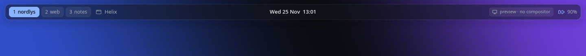
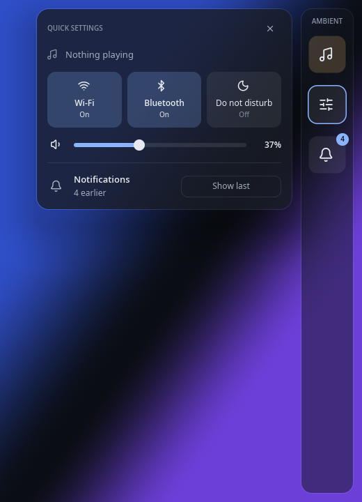

# Nordlys

A frosted, keyboard-first Linux desktop, written in Rust.

The newest window always takes the centre of the screen. The window it
replaces goes to the front of the shelf beside it. Workspaces, app groups
and the same keys work on every screen size, from ultrawide to laptop.

> Early days. The Stage model, config, theme writer and IPC work and are
> tested; the compositor's display backend and the shell UI are not written yet.

## Crates

| Crate | What it is | State |
|---|---|---|
| `nordlys-stage` | The Stage layout model: bring, two-up, swap, shelf, close. Pure logic, no Wayland types. | Working, tested |
| `nordlys-ipc` | JSON-lines protocol over `$XDG_RUNTIME_DIR/nordlys.sock`. | Working, tested |
| `nordlys-config` | `nordlys.toml` (theme, stage, app groups) and the shared palette. | Working, tested |
| `nordlys-theme` | Writes the palette for GTK 3/4 (libadwaita), qt6ct and foot. | Working |
| `nordlysctl` | Command-line control: `nordlysctl two-up`, `nordlysctl group d`… | Working |
| `nordlys-comp` | The compositor, on Smithay. `--headless` runs the Stage model over IPC with no display. | Headless only |
| `nordlys-shell` | Bar, launcher, shelves, notifications, lock screen, on iced and layer-shell. | Top bar and launcher working |

## Build it

Nordlys runs on Hyprland for now. On Arch or CachyOS:

```sh
sudo pacman -S --needed rust hyprland hypridle inter-font ttf-jetbrains-mono \
    playerctl wireplumber networkmanager bluez-utils
git clone https://github.com/nordlys-de/nordlys && cd nordlys
cargo build --release
sudo install -m755 target/release/nordlys-shell target/release/nordlysctl \
    target/release/nordlys-theme /usr/local/bin/
sudo install -m644 config/pam.d/nordlys /etc/pam.d/nordlys
nordlys-shell lock --check     # make sure the lock screen will take your password
```

Then add the `exec-once`, `bind` and `layerrule` lines from the sections
below to `~/.config/hypr/hyprland.conf` and log into Hyprland. (In a VM,
give it 3D acceleration, for example virtio-gpu with OpenGL; Hyprland's
blur needs it.)

On other distros you need the development files for PAM, xkbcommon and
Wayland (Debian/Ubuntu: `libpam0g-dev libxkbcommon-dev libwayland-dev`).

## Try it

```sh
cargo test --workspace

# Terminal 1: the Stage model behind the real socket
cargo run -p nordlys-comp -- --headless

# Terminal 2
cargo run -p nordlysctl -- group d        # launch the "Nordlys dev" group
cargo run -p nordlysctl -- two-up
cargo run -p nordlysctl -- bring nautilus

# Preview generated theme files without touching ~/.config
cargo run -p nordlys-theme -- --config config/nordlys.toml --dry-run
```

Copy `config/nordlys.toml` to `~/.config/nordlys/nordlys.toml` to customise.

## The top bar



```sh
cargo run -p nordlys-shell              # layer-shell bar on Wayland
cargo run -p nordlys-shell -- --window  # preview window (automatic on X11)
```

It shows workspaces (click to switch), what's on stage, the clock, the
layout and the battery. Workspaces come from nordlys-comp when its socket
is up, from Hyprland's IPC on Hyprland, and from a demo set otherwise.

On Hyprland, start it from `hyprland.conf` and let Hyprland blur it. The
layer's namespace is `nordlys-bar`; check the layer-rule syntax for your
Hyprland version:

```ini
exec-once = nordlys-shell
layerrule = blur, nordlys-bar
layerrule = ignorealpha 0.3, nordlys-bar
```

The bar asks for the **Inter** and **JetBrains Mono** fonts and falls back
to the system fonts when they're missing.

## The launcher


```sh
cargo run -p nordlys-shell -- launcher                 # layer-shell overlay on Wayland
cargo run -p nordlys-shell -- launcher --window        # preview window
cargo run -p nordlys-shell -- launcher --query ">"     # open straight into commands
```

One panel finds:

- **Apps** from `.desktop` files (your own entries override system ones).
- **Commands**: your app groups from `nordlys.toml`, the Stage actions
  (two-up, send to shelf, previous, swap), reload config, edit config and
  lock screen.
- **Files** under your home folder: a few levels deep, skipping hidden and
  build folders.

Type `>` for commands only and `/` for files only. Use ↑ ↓ or Tab to
move, Enter to open, Ctrl+Enter to open a file's folder, and Esc or a
click outside to close. Things you open often rise to the top; the counts
live in `~/.local/state/nordlys/launcher-history`.

Stage commands need nordlys-comp. Without it, the launcher says so instead
of closing, and app groups fall back to starting their apps in order.

On Hyprland:

```ini
bind = SUPER, SPACE, exec, nordlys-shell launcher
bind = SUPER SHIFT, SPACE, exec, nordlys-shell launcher --query ">"
layerrule = blur, nordlys-launcher
```

## The shelf and the ambient rail

<p>
  
  
</p>

```sh
cargo run -p nordlys-shell -- shelf             # left rail, layer-shell on Wayland
cargo run -p nordlys-shell -- ambient           # right rail
cargo run -p nordlys-shell -- shelf --window    # preview windows
cargo run -p nordlys-shell -- ambient --window
```

**The shelf** (left) holds the windows waiting on this workspace, most
recent first, numbered by slot. Hover a tile to see its app and title;
click it to bring it on stage. Windows come from nordlys-comp, from
Hyprland's client list, or from a demo set. Live thumbnails need the
compositor to share window pictures, so they arrive with nordlys-comp;
until then each tile shows the app's initial.

**The ambient rail** (right) carries what matters on every workspace: now
playing, quick settings and notifications. Any tile opens the panel, which
has play/pause and next, Wi-Fi, Bluetooth and Do not disturb toggles, a
volume slider (click the percentage to mute) and the notification count.
For now it talks to the standard tools: `playerctl`, `wpctl`, `nmcli`,
`bluetoothctl` and `dunstctl`. A toggle whose tool is missing shows
"Unavailable". Talking to D-Bus directly comes later.

Each rail reserves 88 px on its edge, so windows sit between them. The
surface widens while a hover card or the panel is open.

On Hyprland:

```ini
exec-once = nordlys-shell shelf
exec-once = nordlys-shell ambient
layerrule = blur, nordlys-shelf
layerrule = blur, nordlys-ambient
layerrule = ignorealpha 0.3, nordlys-shelf
layerrule = ignorealpha 0.3, nordlys-ambient
```

## Notifications


```sh
cargo run -p nordlys-shell -- notify            # the daemon, toasts as a layer surface
cargo run -p nordlys-shell -- notify --window   # preview window
```

`nordlys-shell notify` is the notification daemon: it takes the
`org.freedesktop.Notifications` name on the session bus, so every app's
notifications (and `notify-send`) come to it. Toasts pop in at the top
right, newest on top, at most four at a time:

- They stay six seconds unless the app asks otherwise; critical ones stay
  until dismissed, with a red edge. Hovering a toast holds it.
- Click a toast to run its default action, or dismiss it. Action buttons
  and the × work as you'd expect, and the app is told.
- With Do not disturb on, toasts wait quietly in history (critical ones
  still show) and appear when it's switched off.

The ambient rail reads from it: the bell's badge counts what arrived since
you last opened the panel, and the panel lists the three most recent with
**Show last** and **Clear**. Without the daemon the rail falls back to dunst.

Only one notification daemon can run. If dunst (or mako) is running, stop
it first; `notify` says so and exits otherwise. On Hyprland:

```ini
exec-once = nordlys-shell notify
layerrule = blur, nordlys-notify
layerrule = ignorealpha 0.3, nordlys-notify
```

To try it without stopping your current daemon, give it a bus of its own:

```sh
dbus-run-session -- sh -c 'nordlys-shell notify --window & sleep 1; notify-send Hello "From a private bus"; wait'
```

## The lock screen


```sh
nordlys-shell lock --check    # try your password against PAM first
nordlys-shell lock            # lock now (Wayland)
nordlys-shell lock --window   # preview; nothing is locked, the password is "preview"
```

A large clock, your avatar and a glass password card. Typing goes straight
to the password wherever the pointer is: Enter unlocks, Esc or Ctrl+U
clears, and the eye shows what you typed. A wrong password shakes the card.
It warns when Caps Lock looks on, and has suspend, restart and shut down in
the corner (restart and shut down ask for a second click).

While locked, notifications are held with Do not disturb and the clock
says how many are waiting; it's switched back off when you unlock.

It uses the `ext-session-lock-v1` protocol, so the compositor keeps the
session hidden until the password is right, even if the lock screen
crashes. Passwords are checked with PAM, service `nordlys`:

```sh
sudo install -m644 config/pam.d/nordlys /etc/pam.d/nordlys
```

Without that file it uses `login`, which is what the file includes anyway.
Run `lock --check` once before relying on it.

On Hyprland, lock with a key and when idle (with hypridle):

```ini
# hyprland.conf
bind = SUPER, L, exec, nordlys-shell lock

# hypridle.conf
general {
    lock_cmd = pgrep -f "nordlys-shell lock" || nordlys-shell lock
    before_sleep_cmd = loginctl lock-session
}
listener {
    timeout = 300
    on-timeout = loginctl lock-session
}
```

If the lock screen ever crashes, Hyprland shows a red screen and stays
locked. From another TTY, run `hyprctl --instance 0 'keyword
misc:allow_session_lock_restore 1'` and start `nordlys-shell lock` again.

## Roadmap

1. **Shell on Hyprland.** iced and layer-shell top bar, launcher, shelves,
   notifications (`org.freedesktop.Notifications`), quick settings over
   D-Bus (NetworkManager, BlueZ, UPower, MPRIS) and the lock screen
   (`ext-session-lock-v1`). Hyprland blurs layer surfaces, so the frosted
   look works from day one.
2. **nordlys-comp on Smithay.** DRM/KMS and libinput through libseat, the
   Stage layout from `nordlys-stage`, shelf previews at a low frame rate,
   dual-kawase blur, xwayland-satellite for X11 apps.
3. **Polish.** Adaptive shelves (ultrawide, rails, peek), app groups in
   their own workspaces, the SDDM theme (separate repo), a settings app.

## Reused, not rewritten

PipeWire, DRM/KMS, libinput, logind/libseat, xdg-desktop-portal, D-Bus
system services, xwayland-satellite and SDDM. Apps (terminal, files, browser)
are existing ones, themed by `nordlys-theme`.

## Icons

The shell's icons are [Lucide](https://lucide.dev) (ISC licence, see
`crates/nordlys-shell/assets/LICENSE-lucide`), bundled as a 12 KB subset
font so nothing has to be installed. To add an icon, put its name in
`scripts/subset-icons.sh`, run it against a `lucide-font-*.zip` release,
and add the codepoint to `crates/nordlys-shell/src/icons.rs`.

## License

Not chosen yet. GPL-3.0 if we fork an existing Smithay compositor;
MIT/Apache-2.0 is possible if we write `nordlys-comp` from scratch.
Decide before accepting outside contributions.
